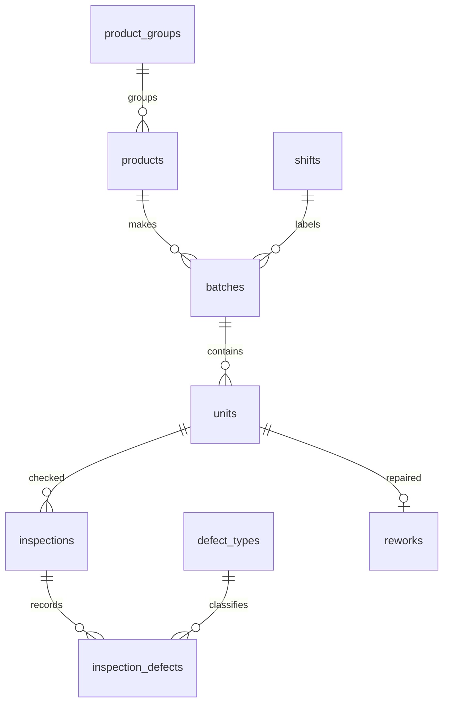

# Từ điển và cấp dữ liệu
| Bảng | Khóa và nội dung |
|---|---|
| product_groups | group_id, name |
| products | product_id, group_id FK, name |
| shifts | shift_id, name; nhãn ca giả lập |
| batches | batch_id, batch_code duy nhất, product_id, shift_id FK, produced_at |
| units | unit_id, unit_code duy nhất, batch_id FK; một món vật lý |
| defect_types | defect_type_id, name |
| inspections | inspection_id, unit_id FK, inspection_no 1/2, inspected_at; UNIQUE(unit_id,inspection_no) |
| inspection_defects | khóa ghép inspection_id/defect_type_id, hai FK |
| reworks | rework_id, unit_id FK duy nhất, completed_at |
| metadata | key/value: simulated, seed, version, kỳ, timezone, quy tắc |

Tất cả ngày giờ YYYY-MM-DD HH:MM:SS, Asia/Ho_Chi_Minh. Lần kiểm tra không lưu result riêng: không dòng lỗi = đạt. Một inspection có thể nhiều loại lỗi nhưng một loại chỉ xuất hiện một lần. 12 dòng lỗi có thể chỉ thuộc 8 đơn vị. Không JOIN chi tiết lỗi rồi COUNT(*) như đếm đơn vị.

Các trạng thái đầu ra loại trừ nhau: not_inspected, initial_passed, waiting_rework, waiting_reinspection, reinspection_passed, reinspection_failed. Tổng sáu trạng thái bằng unit_count. `reworked` chỉ là đã sửa hoàn thành, không nói sửa đã đạt. Các cột initial/reinspection_defect_count đếm dòng loại lỗi. Ngày đầu inspection được giữ riêng với produced_at, không nhầm hai phạm vi.
